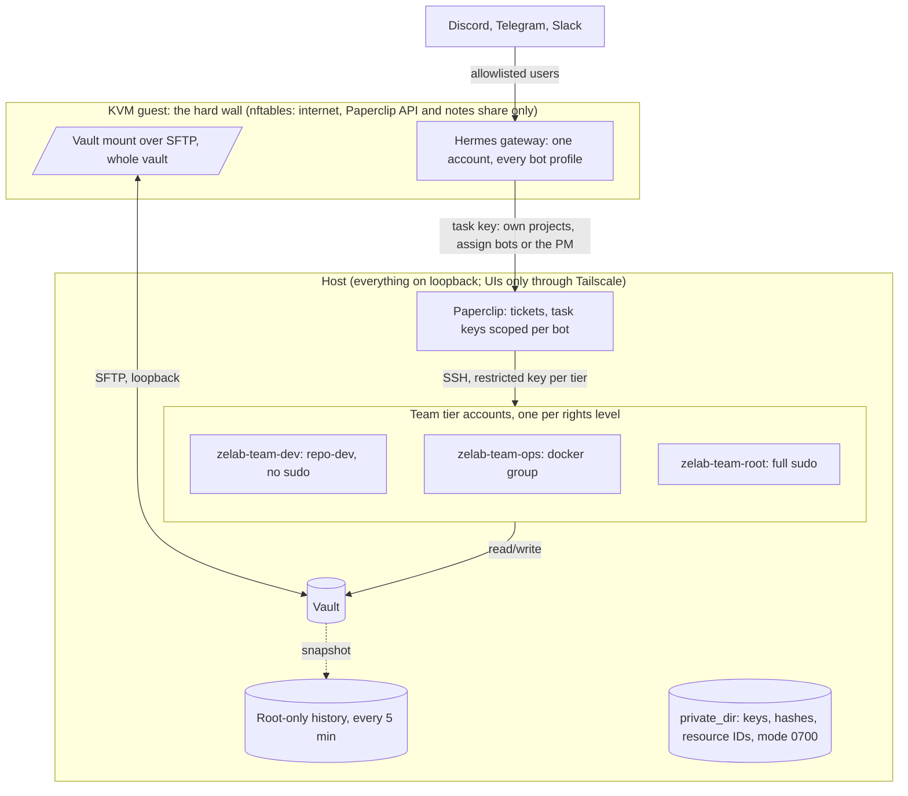
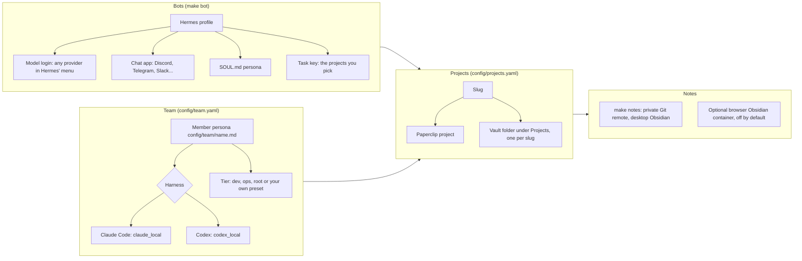

# Zelab

Private chat agents for a home server, built from upstream parts:
[Hermes](https://github.com/NousResearch/hermes-agent) runs in a KVM guest, one
shared gateway serving one Hermes profile per bot, each on its own Discord (or
Telegram, Slack...) identity; [Paperclip](https://github.com/paperclipai/paperclip)
on the host tracks the work and dispatches it to the bots and to a default team
of coding agents (PM, frontend, backend, mobile, game, data, devops, sysadmin),
each on Claude Code or Codex as you choose per member, working on the host over
SSH; one vault holds the notes, one folder
per project, which you open in desktop Obsidian on your laptop through a private
Git repository (`make notes`). Administration UIs are reachable only through Tailscale or localhost.

In a project's channel you ask a bot to research something; it files a Paperclip
ticket and, when Paperclip runs it, writes notes under `Projects/<slug>/`. Chat
itself runs no commands. Work on the server goes to the team's PM, who splits it
across the team; each member runs on its rights tier's own account, and the bot
brings the answer back to the chat in plain words.

## Install

On the Linux server, from this checkout:

```sh
rtk proxy make
```

From a Mac/Linux laptop, driving an existing server checkout over SSH:

```sh
rtk proxy make REMOTE_HOST=user@server REMOTE_DIR=/absolute/path/to/Zelab
```

Plain `make` installs, reapplies or resumes. It asks for your sudo password
once, writes `config/site.yaml` from what it discovers on the host, keeps tool
output in a private log, and on a fresh install asks how many bots to set up,
opening Hermes' own sign-in and chat-app wizards for each. It ends with the URLs
and the steps still waiting for you. Projects and their host accounts come from
`config/projects.yaml` (see `config/projects.example.yaml`). Rerunning keeps all
data and native settings.

Follow the [setup checklist](docs/SETUP.md). Server requirements: x86-64
Debian or Ubuntu with KVM, Docker Compose, OpenSSH, Python 3.12+, Make and
[RTK](https://github.com/rtk-ai/rtk).

## Commands

| Command | Effect |
| --- | --- |
| `rtk proxy make` | Install, reapply or resume; refresh the guide |
| `rtk proxy make clean` | Reset local deployment choices and generated files; keep installed data |
| `rtk proxy make fclean` | Preview and confirm removal of this site's installation/data, then reset local choices |
| `rtk proxy make re` | Full reset, then reinstall |
| `rtk proxy make backup` | Verified encrypted application backup |
| `rtk proxy make restore` | Verify and restore a backup onto a compatible installed site |
| `rtk proxy make bot` | Add, set up or remove Hermes bots (terminal only) |
| `rtk proxy make help` | List these commands |

`fclean` and `re` delete notes, tasks and application logins. Noninteractive
destructive runs need `CONFIRM=<host:vm>`. See [operations](docs/OPERATIONS.md).

## Isolation

Each wall below is an OS account, a firewall rule, a scoped key or a native
product setting, never prompt text. The guest is the only hard wall.



A hijacked bot owns the guest and the shared vault, nothing else; a team
member owns its tier account, nothing above it; note history and credentials
stay where neither can reach.

## Modularity

Every part is one upstream unit you add, swap or remove on its own; `make`
reconciles the rest.



Both CLIs are installed and pinned, so switching a member between Claude Code
and Codex is one line in the team file before hiring, or one setting in
Paperclip afterwards. Every upstream download is pinned and checked.

## Security model in one paragraph

The KVM guest is the hard wall: bots cannot reach the host, the LAN or the
tailnet, only the internet, the Paperclip API and the notes share. Inside the
guest every bot shares one account and the whole vault, so bots are not isolated
from each other; a project that must stay separate needs its own site. Team
members have only their tier account's rights; the `full-sudo` tier's member
is root. Access is enforced by OS accounts, scoped keys and firewall rules, not
prompt text. Secrets stay out of Git and logs; every upstream download is
pinned. Read the [trust model](docs/TRUST_MODEL.md) and [status](docs/STATUS.md).
This is experimental software.

## Documentation

- [Setup](docs/SETUP.md) · [Operations](docs/OPERATIONS.md) · [Architecture](docs/ARCHITECTURE.md)
- [Trust model](docs/TRUST_MODEL.md) · [Status](docs/STATUS.md)
- [Security policy](SECURITY.md) · [Contributing](CONTRIBUTING.md) · [Releasing](docs/RELEASING.md)

Zelab's own source is [MIT licensed](LICENSE). Hermes, Paperclip, Codex, Claude Code,
Obsidian and Tailscale keep their own licenses and account requirements.
