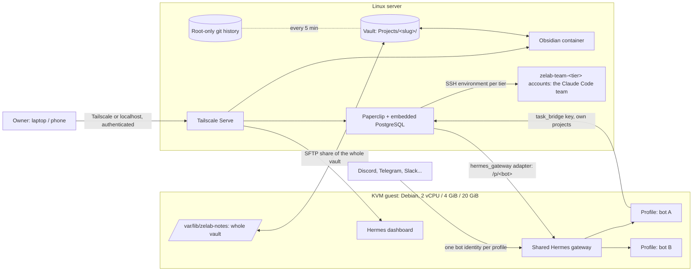

# Architecture

Two links cross the guest boundary, and only where the guest firewall allows:
the Paperclip API port, and the notes SFTP port. The vault history and every
host account stay on the host.

## Components

| Component | Placement |
| --- | --- |
| Hermes | Unmodified upstream checkout in the guest, pinned by commit, with its browser tools (agent-browser and Chromium pinned in Hermes' own lock); one shared gateway serves every profile under the `zelab-hermes` account |
| Bots | One native Hermes profile each, created by `make bot`; each has its own model login, chat app token, `SOUL.md`, memory and sessions in its profile directory |
| Hermes API | The gateway's single API server (port 8642 in the guest, forwarded to host loopback); a bot is reached at `/p/<bot>/` with that profile's own `API_SERVER_KEY` |
| Hermes dashboard | Guest service on port 8640, basic-auth; forwarded to host loopback and published through Tailscale Serve |
| Paperclip | Host service under `zelab-paperclip`, authenticated private mode, loopback only; embedded PostgreSQL reachable only by root, the operator and the service account (nftables) |
| Paperclip bot agents | One `hermes_gateway` agent per bot, hired with `/agent-hires` and approved by `make bot`; `apiBaseUrl` is `http://127.0.0.1:<guest_api_port>/p/<bot>` |
| Task bridge | Paperclip's bundled `paperclip-task-bridge` skill, copied unchanged into each profile; its `task_bridge` key, scoped to the projects the owner picks, is in the profile's `.env` and reaches the terminal tool through Hermes' `terminal.env_passthrough` |
| Zelab skill | A generated `zelab` skill per profile listing projects (Paperclip IDs, vault folders) and the other bots (agent IDs); no secrets |
| Projects | `config/projects.yaml`: a Paperclip project and a vault folder each; no host rights |
| Team tiers | `config/team.yaml`: one account `zelab-team-<tier>` per tier (`dev` repo-dev, `ops` docker, `root` full-sudo; home below `/var/lib/zelab-projects`), read/write on the vault, and the Paperclip SSH environment `<tier> host`; site paths in `config/projects.yaml` |
| Team | Claude Code agents make hires once from `config/team.yaml` (PM as lead; frontend, backend, mobile, game, data on `dev`; devops on `ops`; sysadmin on `root`): Claude CLI engine, Opus 5.5, persona `config/team/<member>.md` plus `TEAM.md` as the first `AGENTS.md`; runs use the owner's Claude sign-in. Both pinned CLIs are installed as `codex` and `claude` |
| Notes | Host vault `/var/lib/zelab-vault` with `Projects/<slug>/`; one notes-only SFTP listener on loopback exports the whole vault; the guest mounts it with SSHFS as the Hermes account |
| Vault history | `/var/lib/zelab-vault-history`, a root-only git directory outside the vault, snapshotted by `zelab-vault-history.timer` every 5 minutes |
| Obsidian | linuxserver.io container pinned by digest, loopback-published, password from a file, vault bind-mounted |
| Provisioning | Ansible roles under `deploy/`, systemd units, one Compose file; Python entry points in `deploy/` and `implementation/` |

## Flows

1. **Chat to ticket (G1).** The owner asks a bot in a project's channel. The
   bot reads its `zelab` skill, writes notes under `Projects/<slug>/`, and
   files a ticket in that project with the task-bridge helper. The ticket is
   assigned to the bot itself, so Paperclip runs it through the bot's
   `hermes_gateway` agent; inside that run the bot comments and closes it,
   passing the run ID Paperclip gives it.
2. **Team work (G2).** From chat, a bot files a ticket for itself; when
   Paperclip runs it, the bot opens a child ticket for the PM, the only team
   member its key may assign. The PM splits it into tickets for the team, which
   Paperclip runs as Claude Code over SSH on each member's tier account. When
   children are done, Paperclip wakes their parent's owner
   (`issue_children_completed`, with each child's summary): the PM closes its
   ticket, then the bot answers the chat it noted on its own.
3. **Owner to bot (G3).** A ticket the owner assigns to a bot in Paperclip is
   dispatched to `/p/<bot>/v1/runs` of the shared gateway.
4. **Bot to bot (G4).** By chat, a bot that allows bots (`DISCORD_ALLOW_BOTS`)
   answers another bot's @mention; by ticket, a bot files work assigned to
   another bot's agent ID, which its key allows.

## State

| State | Location |
| --- | --- |
| Guest disk and cloud-init | `vm_data` (default `/var/lib/zelab-vm/data`) |
| Hermes profiles: logins, chat tokens, SOUL, memory, sessions, task key | `/var/lib/zelab/hermes/home/profiles/<bot>` inside the guest |
| Archived profiles (no logins or tokens) | `/var/lib/zelab/hermes/home/profile-exports` inside the guest |
| Paperclip database, uploads, secrets key, AI connections | `paperclip_home` (default `/var/lib/zelab-paperclip`) |
| Team tier homes and workspaces | `projects_dir` (default `/var/lib/zelab-projects/<tier>`) |
| Notes vault, its history, Obsidian configuration | `/var/lib/zelab-vault`, `/var/lib/zelab-vault-history`, `/var/lib/zelab-obsidian` |
| Deployment keys, project keys, Hermes password hash, resource IDs | `private_dir` (default `~/.local/state/zelab-deployment`) |
| UI password working copies | Private temporary `/dev/shm/zelab-passwords-*` directory during `make`; removed on exit, and stale ones at the next start |

`make backup` archives all of the above together with the source pins, because
a database dump or `.env` alone cannot rebuild a site.

## Network

All backends bind to host loopback. Tailscale Serve publishes the three UIs as
HTTPS on the tailnet only; existing Serve routes are never replaced and Funnel
is refused. The guest reaches the host only on the Paperclip API port and the
notes SFTP port; private ranges, link-local and IPv6 are rejected by nftables
inside the guest. Project SSH keys carry `from=` and `restrict`, and an
`AllowUsers` entry is added only when the host already uses one.

## Resources

Defaults: 2 vCPU, 4 GiB guest RAM, 200 % CPU quota, 4352 MiB memory cap, no
guest swap, 20 GiB disk; 8 GiB host RAM and 20 GiB disk reserves. Measured in
qualification: one gateway with five idle profiles uses about 300 MB, the
guest 720 MiB; a Chromium session adds about 240 MiB. Raising `vm_disk_gib`
grows the disk (QMP `block_resize`) and the guest filesystem (`growpart`,
`resize2fs`) without a restart. A fresh install may temporarily borrow up to
70 % of idle CPU and RAM (`vm_install_resource_fraction`). Hermes web assets
are built on the host. A successful run ends with `prune.yaml`, which deletes
downloads, build trees, releases and images the current pins no longer use.

## Upstream references

- [Hermes profiles](https://hermes-agent.nousresearch.com/docs/user-guide/profiles/),
  [shared gateway](https://hermes-agent.nousresearch.com/docs/user-guide/multi-profile-gateways),
  [dashboard](https://hermes-agent.nousresearch.com/docs/user-guide/features/web-dashboard),
  [Discord](https://hermes-agent.nousresearch.com/docs/user-guide/messaging/discord)
- [Paperclip deployment modes](https://docs.paperclip.ing/reference/deploy/deployment-modes/),
  [Hermes gateway adapter](https://docs.paperclip.ing/reference/adapters/hermes-gateway/),
  [bundled task bridge](https://github.com/paperclipai/paperclip/blob/master/packages/adapters/hermes/README.md),
  [Codex adapter](https://docs.paperclip.ing/reference/adapters/codex/),
  [Claude Code adapter](https://docs.paperclip.ing/reference/adapters/claude-code/)
- [Obsidian container](https://docs.linuxserver.io/images/docker-obsidian/),
  [Tailscale Serve](https://tailscale.com/docs/features/tailscale-serve)
