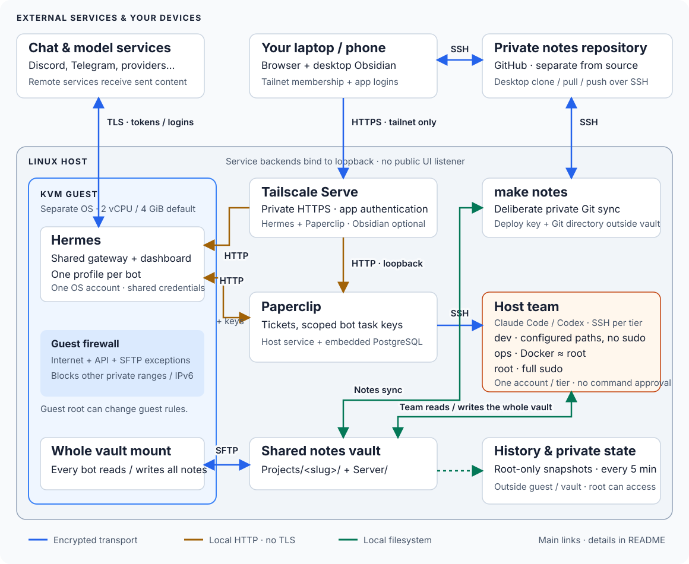

# Architecture

The diagram follows the main work and notes flows. The connection table below
describes transport, authentication and limits, including external model
services and dashboard routes omitted from the overview. Guest-to-host
application traffic has two permitted destinations: the Paperclip API and the
notes SFTP listener. QEMU separately forwards host-loopback ports into the
guest for deployment SSH, the Hermes API and dashboard. The HTTP links have
no TLS; tailnet HTTPS terminates at Tailscale Serve.

Vault history and team accounts stay on the host. The vault is deliberately
shared with the guest, and tickets can deliberately trigger host team work.
Docker and full-sudo tiers can control the host, including its private state.

## Connections

| Link | Protection | Limit |
| --- | --- | --- |
| Your devices → administration UIs | Tailnet-only HTTPS through Tailscale Serve, plus native app authentication; public Funnel is refused | Tailnet permissions and app logins both matter. TLS ends at Serve |
| Serve → Paperclip / Hermes dashboard | HTTP on host loopback; Hermes is reached through a loopback QEMU port forward | These local hops have no TLS; they trust the host and VM boundary |
| Chat / model services ↔ agents | Provider TLS, bot tokens, model logins and Hermes chat allowlists | Providers receive the messages or prompts sent to them; TLS does not prevent prompt injection |
| Hermes profiles → Paperclip tools | Each keyed profile uses the official Paperclip MCP server in the guest over stdio; it calls the host API over HTTP with that bot's scoped task key | MCP provides ticket tools, not run dispatch. No TLS on the guest-to-host HTTP hop. Keyless profiles have this MCP entry disabled |
| Paperclip → Hermes runs | HTTP through a host-loopback QEMU forward, with a separate API key per profile | Keys select profiles; all profiles share one guest account |
| Paperclip → host team | SSH with a key per tier, restricted by source address and native SSH options | The tier account grants command execution; the key is not a command allowlist |
| Guest ↔ vault | SSHFS over key-authenticated SFTP, pinned host key, chroot, no shell or forwarding | Every bot can read, edit and delete the whole vault |
| Vault ↔ desktop notes | Deliberate SSH Git sync through a private repository; server deploy key and Git metadata stay outside the vault | Notes leave the server for GitHub and your laptop; keep Obsidian plugins that execute note content off |
| Vault → local history | Root-only Git snapshots every five minutes, outside the shared vault | Protects against direct bot edits; host root can alter it. Use encrypted backups too |

The guest firewall permits public internet traffic, DNS/DHCP for QEMU, and the
Paperclip API and notes SFTP exceptions. It rejects other private networks,
tailnet addresses and IPv6 for normal bot traffic. These rules live inside the
guest; guest root can change them. Read the [trust model](TRUST_MODEL.md) for
the exact boundaries.

## Components

| Component | Placement |
| --- | --- |
| Hermes | Unmodified upstream checkout in the guest, pinned by commit, with its browser tools (agent-browser and Chromium pinned in Hermes' own lock); one shared gateway serves every profile under the `zelab-hermes` account |
| Bots | One native Hermes profile each, created by `make bot`; each has its own model login, chat app token, `SOUL.md`, memory and sessions in its profile directory |
| Hermes API | The gateway's single API server (port 8642 in the guest, forwarded to host loopback); a bot is reached at `/p/<bot>/` with that profile's own `API_SERVER_KEY` |
| Hermes dashboard | Guest service on port 8640, basic-auth; forwarded to host loopback and published through Tailscale Serve |
| Paperclip | Host service under `zelab-paperclip`, authenticated private mode, loopback only; embedded PostgreSQL reachable only by root, the operator and the service account (nftables) |
| Paperclip bot agents | One `hermes_gateway` agent per bot, hired with `/agent-hires` and approved by `make bot`; `apiBaseUrl` is `http://127.0.0.1:<guest_api_port>/p/<bot>` |
| Task bridge | One `task_bridge` key per bot, scoped to the projects the owner picks, in the profile's `.env`. In chat the bot uses it through Paperclip's official MCP server (`@paperclipai/mcp-server`, same release as Paperclip, locked in `deploy/roles/paperclip_mcp/files`, installed read-only at `/opt/zelab-tools/paperclip-mcp-server` in the guest), limited to `paperclipCreateIssue`, `paperclipGetIssue` and `paperclipListComments`. In a Paperclip run it closes tickets with Paperclip's bundled `paperclip-task-bridge` helper, reconciled unchanged into each profile; the key reaches the terminal through `terminal.env_passthrough` |
| Chat tools | Every chat platform `make bot` sets up (`platform_toolsets.<platform>` in each profile, reset on every `make`) gets web, vision, image generation, speech, skills, to-do, memory, session search, clarify and the Paperclip MCP tools: no terminal, code, file, browser, cron, delegation or kanban tools. Paperclip runs use Hermes' `api_server` tools, which keep the terminal |
| Zelab skill | Written when a bot is added, updated before its task key enables Paperclip tools, and reconciled on every `make`; Hermes' native `skills.auto_load` includes it in each session, retaining other auto-loaded skills; lists only the bot's permitted projects (Paperclip IDs, vault folders), the team and other bots; no secrets |
| Projects | `config/projects.yaml`: a Paperclip project and a vault folder each; no host rights |
| Team tiers | `config/team.yaml`: one account `zelab-team-<tier>` per tier (`dev` repo-dev, `ops` docker, `root` full-sudo; home below `/var/lib/zelab-projects`), read/write on the vault, and the Paperclip SSH environment `<tier> host`; site paths in `config/projects.yaml` |
| Team | Coding agents make hires once from `config/team.yaml` (PM as lead; frontend, backend, mobile, game, data on `dev`; devops on `ops`; sysadmin on `root`). Each member runs on one harness, Claude Code (`claude_local`, default) or Codex (`codex_local`), chosen per member in the file with that harness's model and effort, on Paperclip's CLI engine; persona `config/team/<member>.md` plus `TEAM.md` as the first `AGENTS.md`; runs use the owner's subscription sign-in for that harness. Both pinned CLIs are installed as `codex` and `claude` |
| Notes | Host vault `/var/lib/zelab-vault` with `Projects/<slug>/`; one notes-only SFTP listener on loopback exports the whole vault; the guest mounts it with SSHFS as the Hermes account |
| Vault history | `/var/lib/zelab-vault-history`, a root-only git directory outside the vault, snapshotted by `zelab-vault-history.timer` every 5 minutes |
| Desktop notes | Obsidian on the owner's laptop, on a clone of a private GitHub repository; `make notes` syncs the server vault with it on demand (Git directory, hooks, config and deploy key in `private_dir/notes-sync`, outside the vault and the guest; `.obsidian/`, Git files and symlinks never travel). See [NOTES.md](NOTES.md) |
| Browser Obsidian (optional, off) | linuxserver.io container pinned by digest, loopback-published, password from a file, vault bind-mounted; `obsidian_enabled: false` retires it and its own Tailscale route |
| Provisioning | Ansible roles under `deploy/`, systemd units, one Compose file; Python entry points in `deploy/` and `implementation/` |

## Flows

1. **Chat to ticket (G1).** Someone asks a bot in a project's channel. Chat
   runs no commands: the bot reads its `zelab` skill and, with the Paperclip MCP
   tools, files a ticket in that project assigned to itself, opening with a
   reply block (`Reply to`, `Asked by`, `Question`). Paperclip runs it through
   the bot's `hermes_gateway` agent; in that run the bot does the work (notes go
   under `Projects/<slug>/`), answers the chat with its profile's native
   `hermes send` CLI and closes the ticket with the task-bridge helper and the
   run ID.
2. **Team work (G2).** From chat, in two tool calls, the bot files the job for
   the PM, the only team member its key may assign, and a reply ticket for
   itself that is `blocked` by the job (`blockedByIssueIds`). The PM splits the
   job into tickets for the team, which Paperclip runs as Claude Code over SSH on
   each member's tier account. When the job is done, Paperclip wakes the bot once
   on the reply ticket (`issue_blockers_resolved`); it reads the result with the
   MCP tools, answers in plain words for the person who asked, and closes the
   ticket. Asked for news before then, the bot reads the job in chat. A simple
   status question requests only a narrow current check; detailed evidence stays
   on the tickets.
3. **Owner to bot (G3).** A ticket the owner assigns to a bot in Paperclip is
   dispatched to `/p/<bot>/v1/runs` of the shared gateway.
4. **Bot to bot (G4).** By chat, a bot that allows bots (`DISCORD_ALLOW_BOTS`)
   answers another bot's @mention; by ticket, a bot files work assigned to
   another bot's agent ID, which its key allows.

## State

| State | Location |
| --- | --- |
| Guest disk and cloud-init | `vm_data` (default `/var/lib/zelab-vm/data`) |
| Hermes profiles: logins, chat tokens, SOUL, memory, sessions, task key | `/var/lib/zelab/hermes/home/profiles/<bot>` inside the guest |
| Archived profiles (no logins or tokens) | `/var/lib/zelab/hermes/home/profile-exports` inside the guest |
| Paperclip database, uploads, secrets key, AI connections | `paperclip_home` (default `/var/lib/zelab-paperclip`) |
| Team tier homes and workspaces | `projects_dir` (default `/var/lib/zelab-projects/<tier>`) |
| Notes vault, its history, notes sync, browser Obsidian settings (kept when off) | `/var/lib/zelab-vault`, `/var/lib/zelab-vault-history`, `private_dir/notes-sync`, `/var/lib/zelab-obsidian` |
| Deployment keys, project keys, Hermes password hash, resource IDs | `private_dir` (default `~/.local/state/zelab-deployment`) |
| UI password working copies | Private temporary `/dev/shm/zelab-passwords-*` directory during `make`; removed on exit, and stale ones at the next start |

`make backup` archives all of the above together with the source pins, because
a database dump or `.env` alone cannot rebuild a site.

Plain `make` reconciles bots even without a terminal. It refreshes bundled
skills, terminal credential passthrough and gateway routing, verifies each task
key against Paperclip, and resumes an interrupted key rotation. Project grants
remain the owner's choice; explicit `project_replacements` in
`config/projects.yaml` migrate retired project grants to declared replacements.
Replaced projects are archived only after their open tickets are resolved;
their notes and tickets are retained.

Projects and task keys are optional. A keyless profile still receives the
managed integration and a chat-only skill; its Paperclip MCP entry stays
disabled until a verified task key is written. The guide lists the remaining
setup steps, and plain `make` succeeds.

Both the install wizard and `make bot` reconcile each bot and its chat contexts
as soon as that bot's setup finishes, before another bot or team sign-in wizard.
A skipped setup also reconciles the newly added bot. Leaving a later menu open
does not defer the earlier bot's generated instructions or context refresh.

Team defaults apply when hiring. Subsequent harness, model and AI connection
changes in Paperclip remain authoritative during reapplies.

A private fingerprint covers each profile's persona, configuration, managed
skills and qualified component pins, including the resolved dependency inputs.
On first adoption and after a change,
`make` ends old chat contexts through Hermes' native session API. Transcripts,
logins, memory and Paperclip run sessions remain; the next chat starts with
current instructions. Unchanged reapplies keep the current conversation. Busy
Hermes work defers reconciliation with an actionable failure. Native team
errors are reported for inspection; failed work is never replayed blindly.

## Network

All backends bind to host loopback. Tailscale Serve publishes the three UIs as
HTTPS on the tailnet only; existing Serve routes are never replaced and Funnel
is refused. The guest reaches the host only on the Paperclip API port and the
notes SFTP port; private ranges, link-local and IPv6 are rejected by nftables
inside the guest. These rules constrain normal bot traffic; guest root can
change them. This is not a host-enforced network boundary against guest root.
Project SSH keys carry `from=` and `restrict`, and an
`AllowUsers` entry is added only when the host already uses one.

## Resources

Defaults: 2 vCPU, 4 GiB guest RAM, 200 % CPU quota, 4352 MiB memory cap, no
guest swap, 20 GiB disk; 8 GiB host RAM and 20 GiB disk reserves. Measured in
qualification: one gateway with five idle profiles uses about 300 MB, the
guest 720 MiB; a Chromium session adds about 240 MiB. Raising `vm_disk_gib`
grows the disk (QMP `block_resize`) and the guest filesystem (`growpart`,
`resize2fs`) without a restart. A fresh install may temporarily borrow up to
70 % of idle CPU and RAM (`vm_install_resource_fraction`). Hermes web assets
are built on the host. A successful run ends with `prune.yaml`, which deletes
downloads, build trees, releases and images the current pins no longer use.

## Upstream references

- [Hermes profiles](https://hermes-agent.nousresearch.com/docs/user-guide/profiles/),
  [shared gateway](https://hermes-agent.nousresearch.com/docs/user-guide/multi-profile-gateways),
  [dashboard](https://hermes-agent.nousresearch.com/docs/user-guide/features/web-dashboard),
  [Discord](https://hermes-agent.nousresearch.com/docs/user-guide/messaging/discord)
- [Paperclip deployment modes](https://docs.paperclip.ing/reference/deploy/deployment-modes/),
  [Hermes gateway adapter](https://docs.paperclip.ing/reference/adapters/hermes-gateway/),
  [bundled task bridge](https://github.com/paperclipai/paperclip/blob/master/packages/adapters/hermes/README.md),
  [MCP server](https://www.npmjs.com/package/@paperclipai/mcp-server),
  [Codex adapter](https://docs.paperclip.ing/reference/adapters/codex/),
  [Claude Code adapter](https://docs.paperclip.ing/reference/adapters/claude-code/)
- [Obsidian container](https://docs.linuxserver.io/images/docker-obsidian/),
  [Tailscale Serve](https://tailscale.com/docs/features/tailscale-serve)
