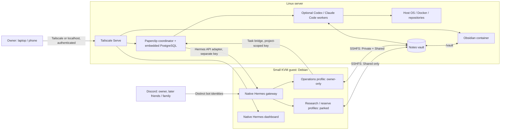

# Architecture

## Components

| Component | Placement |
| --- | --- |
| Hermes | Unmodified upstream checkout in the guest, pinned by commit; one shared gateway runs every profile under the `zelab-hermes` account |
| Hermes dashboard | Guest service on port 8640, basic-auth; forwarded to host loopback and published through Tailscale Serve |
| Paperclip | Host service under `zelab-paperclip`, authenticated private mode, loopback only; embedded PostgreSQL reachable only by root, the operator and the service account (nftables) |
| Host workers | `zelab-ops` (unattended sudo) and `zelab-code` (no privileges, paused), reached by Paperclip's SSH environment driver; setup offers pinned Codex, Claude Code, both or skip. Both and skip create paused inert agents until a harness is chosen; existing native settings are retained. |
| Notes | Host vault `/var/lib/zelab-vault/{Private,Shared}`; a dedicated notes-only SFTP listener on loopback; SSHFS mounts in the guest per audience |
| Obsidian | linuxserver.io container pinned by digest, loopback-published, password from a file, vault bind-mounted |
| Provisioning | Ansible roles under `deploy/`, systemd units, one Compose file; Python entry points in `deploy/` and `implementation/` |

## Flows

1. The owner asks Operations in an admitted Discord conversation.
2. Hermes runs the bundled `paperclip-task-bridge` skill. Task creation uses
   `submit-task.mjs`, a stateless client that derives a Paperclip idempotency
   key from Hermes' per-message identity, so retries never duplicate work.
3. The task lands in the Operations project assigned to the `zelab-ops` worker.
   Once a harness is selected and authenticated, Paperclip opens the SSH
   environment and runs Codex or Claude Code there with real host access.
4. Operations reads the result through the same scoped key and replies in the
   originating conversation with host identity, timestamp and task ID.
5. Paperclip can also assign work to Hermes through its native gateway adapter,
   using a second, separately scoped key.

## State

| State | Location |
| --- | --- |
| Guest disk and cloud-init | `vm_data` (default `/var/lib/zelab-vm/data`) |
| Hermes profiles, memory, logins, Discord token | `/var/lib/zelab/hermes/home` inside the guest |
| Paperclip database, uploads, secrets key | `paperclip_home` (default `/var/lib/zelab-paperclip`) |
| Worker homes | `/var/lib/zelab-ops`, `/var/lib/zelab-code` |
| Notes vault, Obsidian configuration | `/var/lib/zelab-vault`, `/var/lib/zelab-obsidian` |
| Deployment keys, Hermes password hash, resource IDs and optional legacy recovery copies | `private_dir` (default `~/.local/state/zelab-deployment`) |
| UI password working copies | Private temporary `/dev/shm/zelab-passwords-*` directory during `make`; removed on exit |
| Obsidian native startup password | Root-owned `/etc/zelab-obsidian/password` |

Hermes memory stays in Hermes; task history stays in Paperclip; the vault holds
durable human-readable notes. `make backup` archives all of the above together
with the source pins, because a database dump or `.env` alone cannot rebuild a site.

## Network

All backends bind to host loopback. Tailscale Serve publishes the three UIs as
HTTPS on the tailnet only; existing Serve routes are never replaced and Funnel
is refused. The guest reaches the host only on the Paperclip API port and the
notes SFTP port; private ranges, link-local and IPv6 are rejected by nftables
inside the guest, and restricted tool UIDs are additionally blocked from the
Paperclip port. Worker SSH keys carry `from=` and `restrict` options and an
`AllowUsers` entry is added only when the host already uses one.

## Resources

Defaults: 1 vCPU, 2 GiB guest RAM, 50 % CPU quota, 2304 MiB memory cap, no
guest swap, 16 GiB disk; 8 GiB host RAM and 20 GiB disk reserves. A fresh
install may temporarily borrow up to 70 % of idle CPU and RAM for the first
boot and restores the normal limits afterwards (`vm_install_resource_fraction`).
Hermes web assets are built on the host, not inside the small guest.

## Upstream references

- [Hermes profiles](https://hermes-agent.nousresearch.com/docs/user-guide/profiles/),
  [shared gateway](https://hermes-agent.nousresearch.com/docs/user-guide/multi-profile-gateways),
  [dashboard](https://hermes-agent.nousresearch.com/docs/user-guide/features/web-dashboard),
  [Discord](https://hermes-agent.nousresearch.com/docs/user-guide/messaging/discord)
- [Paperclip deployment modes](https://docs.paperclip.ing/reference/deploy/deployment-modes/),
  [Hermes gateway adapter](https://docs.paperclip.ing/reference/adapters/hermes-gateway/),
  [bundled task bridge](https://github.com/paperclipai/paperclip/blob/master/packages/adapters/hermes/README.md),
  [Codex adapter](https://docs.paperclip.ing/reference/adapters/codex/),
  [Claude Code adapter](https://docs.paperclip.ing/reference/adapters/claude-code/)
- [Obsidian container](https://docs.linuxserver.io/images/docker-obsidian/),
  [Tailscale Serve](https://tailscale.com/docs/features/tailscale-serve)
