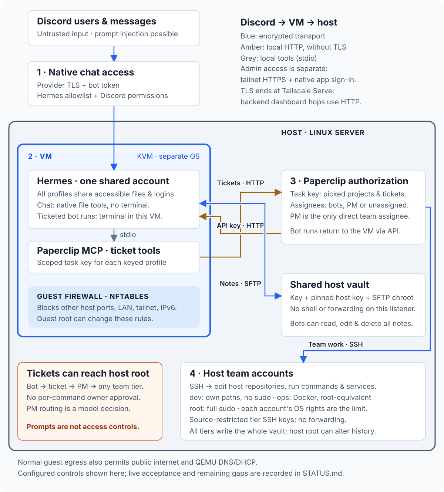

# Architecture

## Where everything runs

- **VM:** Hermes bots chat, research and write notes. All profiles share one guest account.
- **Host:** Paperclip runs the team as host OS accounts: they edit code, run builds and tests, and manage services within their tier's rights.
- **Notes:** bots and team write the same vault. Private Git sync brings it to desktop Obsidian.

Notes need no ticket. Tracked work goes through Paperclip: it starts a bot run
in the VM or gives the job to the PM, who delegates to the host team.

## From Discord to the host

The VM separates operating systems. Two deliberate paths cross it: tickets
to Paperclip and notes over SFTP. **Tickets can reach the full-sudo host team
through the PM, without owner approval.** The guest firewall limits normal
bot traffic; guest root can change it.

See the [trust model](TRUST_MODEL.md) for authority and accepted risks,
[Status](STATUS.md) for what has been exercised, and [Notes](NOTES.md) for sync.

## Connections

Transport, authentication and limits

| Link | Protection | Limit |
| --- | --- | --- |
| Browser → dashboards | Tailnet HTTPS through Tailscale Serve + app login; no public Funnel | TLS ends at Serve; backend hops use HTTP |
| Chat / model providers ↔ agents | Provider TLS, bot tokens, model logins, native chat allowlists | Providers receive the content sent to them; prompt injection remains possible |
| VM MCP tools → host Paperclip | HTTP + each bot's scoped task key | Ticket tools only; no TLS. Keyless profiles have MCP disabled |
| Paperclip → VM bot runs | HTTP through a host-loopback QEMU forward + profile API key | Keys select profiles; profiles share one guest account |
| Paperclip → host team | SSH, source-restricted tier keys with native SSH restrictions | The tier's OS rights allow commands; the key is not a command allowlist |
| VM ↔ host vault | SSHFS/SFTP, key authentication, pinned host key, chroot, no shell or forwarding | Every bot can read, edit and delete the whole vault |
| Vault ↔ laptop | On-demand SSH Git sync through a private repository | Deploy key and Git metadata stay outside the vault; keep plugins that execute notes off |
| Vault → history | Root-only Git snapshots outside the vault, every five minutes | Host root can alter history; keep encrypted backups too |

Guest nftables permits public internet, QEMU DNS/DHCP and the two host
application destinations above. Other private networks, tailnet addresses and
IPv6 are rejected for normal bot traffic. The rules run inside the guest.
QEMU separately forwards host-loopback ports into the guest for deployment
SSH, the Hermes API and dashboard.

Runtime and configuration reference

## Components

| Component | Implementation |
| --- | --- |
| Hermes | Upstream checkout pinned by commit; one gateway under guest account `zelab-hermes`; one native profile per bot |
| Bot profiles | Own model login, chat token, SOUL, memory and sessions; created with `make bot`. Profile directories are not access boundaries |
| Hermes API / dashboard | Guest ports 8642 / 8640, forwarded to host loopback. API: `/p/<bot>/` with a profile key; dashboard: basic auth |
| Paperclip | Host service `zelab-paperclip`, authenticated private mode, loopback only. Database network access limited to root, operator and service account |
| Ticket tools | Official `@paperclipai/mcp-server`, release matched to Paperclip, read-only installation in the VM. Chat creates/reads tickets and lists comments; runs close tickets with the bundled task-bridge helper and run ID |
| Chat tools | Native files, skills, research and memory; Discord also has message/member/thread tools. No terminal, code, browser, cron, delegation or kanban. File access follows guest account rights beyond the vault; ticketed API runs retain terminal access |
| Zelab skill | Native `skills.auto_load`; lists permitted projects, notes folders and team routing. Reconciled before ticket tools are enabled |
| Projects | `config/projects.yaml`: Paperclip projects and vault folders; no host rights |
| Team | `config/team.yaml`: PM and specialists, each on Claude Code or Codex with Paperclip's CLI engine and subscription sign-in. Persona from `config/team/<member>.md` + `TEAM.md` at hire |
| Tier accounts | `zelab-team-<tier>`: `dev` has no sudo, `ops` has Docker (root-equivalent), `root` has full sudo. Paths are granted in `config/projects.yaml`; all tiers write the vault |
| Vault | Host `/var/lib/zelab-vault`, VM `/var/lib/zelab-notes`. `Hermes/<bot>/` for personal notes; `Paperclip/Projects/<slug>/` and `Paperclip/Server/` for shared knowledge. Existing root `Projects/` and `Server/` notes stay in place |
| Provisioning | Ansible, systemd, QEMU/KVM and Docker Compose; Python entry points in `deploy/` and `implementation/` |

## Flows

1. **Direct notes (N3):** bundled Obsidian skill → native files → vault → read-back.
   No task key or project is needed for personal notes.
2. **Tracked bot work (G1):** MCP ticket assigned to the bot → Paperclip gateway
   run → work in VM → native `hermes send` reply → close ticket with run ID.
3. **Team work (G2):** job for PM + bot reply ticket blocked by that job → host
   team works over SSH → blocker resolution wakes the bot → chat reply.
4. **Owner to bot (G3):** assign a ticket in Paperclip → `/p/<bot>/v1/runs`.
5. **Bot to bot (G4):** permitted ticket assignment, or Discord @mention when
   `DISCORD_ALLOW_BOTS` admits bots.

## State

Private state stays outside this repository. Guest profiles live under
`/var/lib/zelab/hermes/home/profiles/<bot>`; archived profiles without
credentials live under `profile-exports`. Host state includes the VM disk
(`vm_data`), Paperclip (`paperclip_home`), team homes (`projects_dir`),
the vault, root-only `/var/lib/zelab-vault-history` and deployment credentials
(`private_dir`). Notes Git metadata and keys live in `private_dir/notes-sync`.
UI password working copies use private temporary RAM directories.

`make backup` captures state and pins together; see
[Operations](OPERATIONS.md#backup-and-recovery) for locations and recovery.

Plain `make` reconciles skills, routing and task keys, including interrupted
rotation. Projects and keys are optional. Retired project replacements are
explicit; old projects archive only after their open tickets finish. Each
bot's setup refreshes its configuration before the next wizard. Team settings
edited in Paperclip stay authoritative after hire.

Changed persona, configuration, skills or qualified pins end old chat contexts
through Hermes' native API, retaining transcripts, logins, memory and run
sessions. Unchanged applies keep conversations. Busy work defers reconciliation;
failed team work is reported for inspection, never replayed blindly.

## Network

Paperclip and the forwarded Hermes dashboard use host-loopback backends.
Tailscale Serve publishes them as tailnet HTTPS without replacing unrelated
routes. Tier SSH keys carry `from=` and `restrict`; `AllowUsers` is extended
only if the host already uses it. See the connection table above for limits.

## Resources

Defaults: 2 vCPU, 4 GiB guest RAM, 200% CPU quota, 4352 MiB memory cap, no guest
swap, 20 GiB disk; host reserves of 8 GiB RAM and 20 GiB disk. Qualification
measured about 300 MB for five idle profiles, 720 MiB for the guest and 240 MiB
extra for Chromium. Increasing `vm_disk_gib` grows the disk and filesystem
without restart. Fresh installs may borrow up to 70% of spare CPU/RAM through
`vm_install_resource_fraction`. Hermes web assets build on the host.
Successful provisioning prunes downloads and runtimes unused by current pins.

## Upstream references

[Hermes profiles](https://hermes-agent.nousresearch.com/docs/user-guide/profiles/) ·
[Shared gateway](https://hermes-agent.nousresearch.com/docs/user-guide/multi-profile-gateways) ·
[Paperclip Hermes adapter](https://docs.paperclip.ing/reference/adapters/hermes-gateway/) ·
[Paperclip MCP](https://www.npmjs.com/package/@paperclipai/mcp-server) ·
[Tailscale Serve](https://tailscale.com/docs/features/tailscale-serve)

