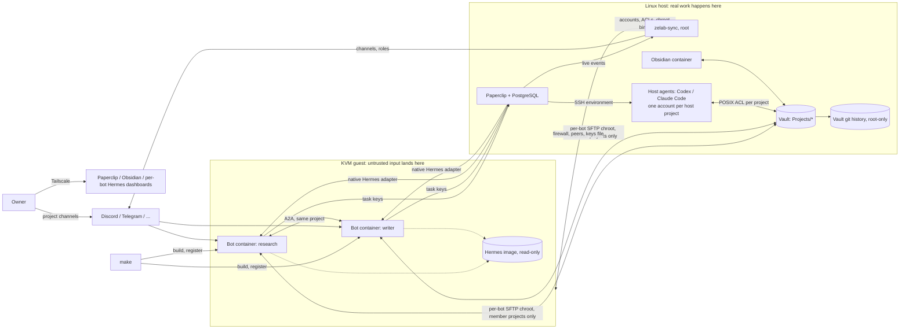

# Zelab v2 architecture

Status: design agreed with the owner on 2026-10-14 and reworked on 2026-10-15
after qualification against the pinned Paperclip and Hermes. Not implemented yet.
Results are under [Qualification](#qualification); items still open are listed
there and must pass before the live switch. The current system is described in
[ARCHITECTURE.md](ARCHITECTURE.md) and [TRUST_MODEL.md](TRUST_MODEL.md); this page
replaces both when v2 ships.

## Principle: use the tools as built

Paperclip and Hermes are used the way they are designed. Their own concepts,
defaults and flows decide who may do what in them: Paperclip's tickets, task
keys, hire approvals, environments and AI connections; Hermes' profiles,
gateway, A2A, dashboard and setup wizards. Zelab does not re-implement or
override their permissions. Where a tool's default leaves a gap, the gap is
written down as an accepted risk instead of being patched.

Zelab adds only what neither tool does: the guest, the bot containers, the
vault and its file permissions, per-project host accounts, Discord channels and
roles, and the glue that keeps those aligned with Paperclip (zelab-sync).

## Goal

Several Hermes bots and Paperclip host agents work on **projects**. Every project
has one folder of human-readable memory in the Obsidian vault. You decide, per
project, which bots and agents are on it (members get full access, everyone
else none) and whether it may touch the host. Your own notes are simply a
project with no members. Bots keep every Hermes feature; safety comes from where
things run and which credentials they hold, never from disabling tools or from
prompt text.

Typical use: "@research do the market research for Acme" in the Acme Discord
channel ends with notes in `Projects/acme/` in Obsidian, a ticket on the
Paperclip board, and, if host work was needed, a host agent having done it.

## Decisions

| Topic | Decision |
| --- | --- |
| Hermes features | Everything enabled except computer use, which needs a desktop: code execution, browser, plugins, MCP, cron, delegation, skills, A2A. The Research drift lock and toolset restrictions are removed. |
| Isolation | Keep the KVM guest as the wall to the host. One container per Hermes bot inside it: rootful podman, a separate user namespace per bot (root inside is an unprivileged guest UID) and a separate routed bridge per bot, so the guest firewall sees every bot's traffic by interface. |
| Bot base | Hermes' own container image, built unmodified from the pinned upstream `Dockerfile` with Docker BuildKit on the host and loaded into the guest's podman. `/opt/hermes` is read-only and shared by every bot; each bot's state, skills, plugins and plugin dependencies live in its own `/opt/data`. Computer use is off. All bots run the same image. |
| Guest size | 2 vCPU, 6 GiB RAM and a 20 GiB thin disk in normal operation. The install borrows idle host CPU and RAM (`vm_install_resource_fraction`, as in v1) and restarts the guest at the normal size afterwards. `make` grows the disk live. The VM starts with a fixed number of pre-forwarded bot slots (default 10, with API and dashboard ports each), so adding a bot needs no VM restart while a slot is free. |
| Source of truth for memory | The vault. Hermes native memory stays per bot and small. |
| Registry | Paperclip: one company, many projects. A Paperclip project is the unit of access. |
| Membership | An agent is a member of project P if it holds an open ticket in P (any status except done or cancelled), or if it is P's lead in Paperclip's own `leadAgentId`. Zelab never sets a lead; none exists after install. For standing access, the owner assigns a ticket and leaves it in Backlog, which does not wake the agent. Removing an agent means closing or reassigning its tickets in P. Members get full access, non-members none. |
| Missions | Any agent task. Real work becomes a Paperclip ticket; quick exchanges stay in chat. The bot decides with rules from a Zelab skill; the owner can override. |
| Bots in Paperclip | Every bot is also a Paperclip agent with the native `hermes_gateway` adapter, so tickets flow both ways. `make` builds the bot first, then registers it through Paperclip's hire flow (`/agent-hires`, then approval), because Paperclip's hire form expects a running Hermes API. |
| Bot-to-bot | Light path: Hermes' bundled A2A plugin. Bots call each other directly inside the guest with named per-peer tokens. Optional visible path: @mentions in a shared chat channel (`DISCORD_ALLOW_BOTS`, `TELEGRAM_ALLOW_BOTS` or Slack `allow_bots` set to `mentions`). Heavy path: Paperclip tickets and comment @mentions. Handoffs happen only between members of the same project. |
| Messaging | Each bot uses whichever platform it is set up with: Discord, Telegram, Slack and others, through Hermes's native gateway setup. Zelab automates Discord only: one channel per project, and Discord roles decide which bots can see it. Chats on other platforms are managed by the owner. Paperclip's own chat channels are not used. |
| Paperclip permissions | Paperclip's defaults, unmodified. Bots hold no general Paperclip key: the Hermes gateway adapter passes none, and each bot's only key is its task key. Host agents run with Paperclip's standard per-run agent key. Zelab does not edit grants, trust presets or assignment policies. |
| Task keys | One Paperclip `task_bridge` key per bot, as the adapter's bundled `paperclip-task-bridge` skill expects. Scope: the bot's projects, and as assignees the agents that share a project with it plus the host agents of its `host_auto` projects. Paperclip cannot edit a key's scope, so on a membership change the sync creates the replacement and then revokes the old key. |
| Host agents | Paperclip's Codex and Claude Code agents run on the host through Paperclip's SSH environment driver and do real sysadmin, DevOps and repository work. Each host project has its own host account with a rights preset, and its own Paperclip SSH environment, named after the project. The owner hires host agents in Paperclip's UI and picks that environment in the hire form. |
| Host gate | Per project: `host_auto` puts the project's host agents in its member bots' task keys; otherwise bots file tickets and the owner assigns. |
| Project memory writes | Each agent writes only its own log in the project. Only the owner, and the project's lead if one is set, can write `MEMORY.md`, enforced by file ACLs that the sync applies. |
| Version history | The host commits the vault to a git history every few minutes. Bots cannot reach that history. |
| Model credentials | Subscriptions only. Each bot signs in with its own Hermes login: Hermes' subscription refresh tokens are single-use, so one login cannot be shared across containers. Host agents use Paperclip's AI connection local sign-in: Paperclip shows a command (`codex login --device-auth` or `claude auth login`) to run on the host, keeps the login, and copies it to the SSH host account for each run. v1's copied Codex auth file goes away. |
| Owner Obsidian access | Browser only, through the existing Obsidian container. |
| Admin UI | None, and no Paperclip plugin. Projects, tickets, agents and host agents are managed in Paperclip's own UI, notes in Obsidian, bot settings in each bot's Hermes dashboard, and bots and host rights in the site config, `config/projects.yaml` and `make`. |
| Migration | Fresh start: the current Hermes profiles, vault layout and Paperclip company are not carried over. |
| Delivery | One refactor, switched over once. |

## Layout



## Components

| Component | Runs as | Purpose |
| --- | --- | --- |
| KVM guest | `zelab-vm` | The bot box. Bot slots' API and dashboard ports are forwarded to host loopback by plain QEMU options at VM start; free slots are unused until a bot takes them. |
| Guest firewall | nftables in the guest | Guest processes reach only the Paperclip API and the notes SFTP port on the host. Bot bridges reach public internet, the Paperclip API port and DNS; they cannot reach the guest itself, other bots (except A2A between listed pairs), the host's other ports, the LAN, the tailnet or IPv6. |
| Bot container | One rootful podman container per bot, user namespace `2000000 + 65536 × slot`, bridge `zb<slot>` | Hermes' own image running `gateway run` with its API server, A2A and dashboard under s6. Mounts: its `/opt/data`, `/vault` (the bot's SFTP view of its projects, propagated live) and a read-only `/zelab` with its memberships, task key and the Zelab skill. |
| Hermes image | Read-only image layers | Built from the pinned upstream archive with the qualified dependency manifests. Upgraded only through a qualified pin change. |
| Paperclip | `zelab-paperclip` on host loopback | Registry, ticket board, AI connections for host agents, and dispatch to bots and host agents. `requireBoardApprovalForNewAgents` is on. |
| Host agents | Per-project host accounts `zelab-p-<slug>` | Codex or Claude Code through Paperclip's SSH environment driver, with the rights of their project's preset. |
| Vault | Host `/var/lib/zelab-vault` | `Projects/<slug>/` only. Each project has a POSIX group for its host account; bots get per-user ACLs. |
| Notes SFTP | Dedicated loopback `sshd` | One account `zelab-b-<bot>` per bot, chrooted to a directory that contains bind mounts of its member projects only. The guest mounts it once with SSHFS (`allow_other`, `dir_cache=no`); bots never hold SFTP keys. |
| Vault history | Root timer, git directory outside the vault | Snapshot commits every few minutes. Restore is a git checkout run by the owner. |
| zelab-sync | Root service on the host | Listens to Paperclip's live event stream and converges the state below. Never sits between an agent and its data. |
| Zelab sync agent | An inert Paperclip agent (`process` adapter, `/usr/bin/false`, heartbeat and wake-on-demand off) | Paperclip's live stream accepts agent keys and browser sessions, not board keys. This agent's key, readable only by root, is used for nothing but the stream. |
| Sync board key | Paperclip board API key, readable only by root | Created by `make` with the owner's session. Used by the sync and `make` for every Paperclip change Zelab makes. |
| Discord admin bot | Token readable only by root, used only by zelab-sync | Creates project channels and per-bot roles and keeps them aligned with memberships. Hermes bots never hold it. |

## What zelab-sync applies

Inputs: Paperclip projects, leads, agents and open-ticket assignees,
`config/projects.yaml` and the site config. Any live event triggers a
recomputation of the desired state from Paperclip's current data, debounced by a
few seconds; event payloads are only a trigger. Paperclip's event bus has no
replay, so the sync converges fully when it starts, after every reconnect of the
stream, and whenever `make` runs. It is idempotent.

| Paperclip change | Applied state |
| --- | --- |
| Project created | `Projects/<slug>/` with `MEMORY.md`, `Agents/`, `Missions/`, its group, and a Discord channel visible to nobody but the owner. The slug is fixed when the folder is created; renaming the project later does not move it. |
| Membership changed (ticket assigned or reassigned, last open ticket closed, lead set or cleared) | Bind mounts in the bot's SFTP chroot and the vault ACLs; file ACLs on `MEMORY.md` and on each agent's own log; host account group membership; Discord role; A2A peer list and guest firewall pairs between same-project bots; a replacement task key; `/zelab/memberships.json`. Nothing restarts. |
| Host agent hired or edited | Reported if its environment is not a host project's, or if it is a member of a host project other than its environment's. |
| Agent terminated in Paperclip | A retired bot's container stops, its data is archived and its slot freed; its task key is revoked and its roles removed. |

Host accounts, presets and SSH environments are created only from
`config/projects.yaml`, never from Paperclip data. The sync never changes
Paperclip permissions, trust presets or assignment policies.

## Setup flow

Plain `make` stays the only installer. When it runs interactively it asks:

1. **How many Hermes bots?** The default is the number that already exist, or 1
   on a fresh site. A higher number adds bots; `make` never removes one. To
   retire a bot, terminate its agent in Paperclip.
2. For each new bot: **a name, a one-line role and a dashboard password**
   (hidden input with confirmation). The name and role become the bot's Paperclip
   agent and its Hermes profile description.
3. For each new bot, any of these steps can be skipped:
   - **Model sign-in:** the native `hermes setup model` wizard, including the
     subscription OAuth login.
   - **Messaging:** the native `hermes setup gateway` wizard for the platform you
     choose for that bot (Discord, Telegram, Slack…). It takes the platform token
     in the terminal, never in chat. The guide first shows how to create the
     platform's bot application, since that step cannot be automated.
   - **SOUL:** paste a persona or open an editor; otherwise Hermes seeds its
     default.

Each new bot is built in a free slot, started on its own (bots are started one
at a time, because simultaneous starts can push Hermes' platform plugins past
their load timeout), checked through its API, and then registered in Paperclip
through `/agent-hires` and approval with the sync's board key.

Once per site, `make` also takes the Discord admin bot token as hidden terminal
input (skippable: project channels are then not automated), creates the sync's
board key and the inert sync agent and its key. These secrets stay root-only on
the host. Host agents sign in through Paperclip's AI connection screens.

Skipped steps appear in the HTML checklist and can be finished later in that
bot's dashboard. A noninteractive `make` reads `hermes_bots: <n>` from the site
config and skips every wizard and password prompt; those bots' dashboards stay
unreachable until a password is set by an interactive `make`.

## Host rights: `config/projects.yaml`

```yaml
projects:
  homelab:                 # project slug (its vault folder name)
    host_preset: full-sudo # none | monitor-readonly | docker | repo-dev | full-sudo
    host_auto: false       # bots file host tickets; the owner assigns
    paths: [/srv/homelab]
  acme:
    host_preset: none      # research only, no host agents
```

Presets are a fixed catalogue in Zelab: groups, sudoers fragments and owned
paths. A project without an entry has no host account and no environment, so
Paperclip cannot dispatch host work for it. For a project with one, the sync
creates the account `zelab-p-<slug>`, its SSH key and the Paperclip SSH
environment `<slug> host`. The owner then hires a Codex or Claude Code agent in
Paperclip and selects that environment.

## Memory layers

1. **Bot memory**: Hermes native `MEMORY.md`/`USER.md` in each container, private
   to that bot. Holds who it is and what it has learned, not project facts.
2. **Project memory**: `Projects/<slug>/MEMORY.md`, curated by the owner and the
   project's lead when there is one. It's the first file a bot reads when it
   works on the project.
3. **Agent logs**: `Projects/<slug>/Agents/<agent>.md`, written only by that agent.
4. **Mission notes**: `Projects/<slug>/Missions/<ticket>-<slug>/`, linked from the
   Paperclip ticket.
5. **Work history**: Paperclip tickets, comments and documents.

The project folder and `Agents/` are sticky and `MEMORY.md` is owned by root, so
an agent cannot delete or replace files it cannot write.

Recall uses a Zelab Hermes skill, `zelab-projects`, mounted read-only into every
bot. It covers the bot's current projects (from `/zelab/memberships.json`), the
folder conventions, when to escalate to a ticket, same-project handoffs, and
how to call the bundled task-bridge helper with the key in `/zelab`. Each bot
gets `OBSIDIAN_VAULT_PATH=/vault` and `HERMES_WRITE_SAFE_ROOT=/opt/data:/vault`,
so the upstream `obsidian` skill works too. The skill is guidance; the
boundaries are the mounts, file ACLs, keys, Discord roles and the guest firewall.

## A2A

Each bot's A2A server listens on port 9900 inside its container with Hermes'
named per-peer tokens (`A2A_PEER_TOKENS`, `A2A_TRUSTED_PEERS`). Hermes reads
them only at start, so when a bot is created it gets one inbound token for each
slot, and its peers are named after the slots. Who can call whom is decided at
runtime by the guest firewall (only pairs of bots that share a project) and by
each caller's `a2a_agents` list in its `config.yaml`, which Hermes reads on
every call and the sync keeps to the current same-project peers. No bot restarts
when membership changes.

## Trust boundaries

Every boundary lives outside the bot. A bot can rewrite its own Hermes config,
skills and SOUL, so none of those can be a security limit.

| A hijacked bot can | It cannot, because |
| --- | --- |
| Do anything inside its container, use its subscription login, and read or write its projects | It cannot read another bot's data, other projects, the guest or the host: user namespaces, the SFTP chroot and vault ACLs prevent it |
| File tickets in its projects and read tickets it created or holds | It cannot create tickets outside its projects or read other tickets: Paperclip's `task_bridge` key scope prevents it |
| Assign tickets to agents that share a project with it | It cannot assign anyone else, nor host agents of projects that are not `host_auto`: the key's allowed assignees prevent it |
| Message bots in its project channels, or call same-project bots over A2A | It cannot see other projects' Discord channels or reach other bots: Discord roles and the guest firewall prevent it |
| Damage files in an assigned project | It cannot erase the history: the git history is root-only on the host |

Accepted risks:
- Information flows between bots that share a project.
- A guest kernel or container-runtime escape exposes every bot's projects (the
  union) and every bot login, but still not the host.
- A bot in several projects can assign a ticket in one of them to an agent from
  another, which makes that agent a member. Its task key spans all its projects
  because Paperclip gives the bridge one key per bot.
- A bot in a `host_auto` project can give that project's host agent tickets in
  any of the bot's projects. The host agent still runs as its own project's
  account.
- Host agents run with Paperclip's standard agent key. Following a ticket, one
  can read every ticket in the company and create and assign tickets in any
  project, including to another project's host agent. Paperclip's own limit for
  this, the low-trust preset, only runs in Paperclip sandboxes, not over SSH.
  Treat every host agent as able to reach every other host agent's preset.
- A host agent with the `full-sudo` preset is root on the host. It can read every
  project, Paperclip's database and Zelab's secrets.
- A hijacked bot can steal its own subscription login. Revoke that session at
  the provider.
- Chats on platforms other than Discord are not managed by Zelab. Who sees them
  is the owner's setting in that platform.

## Resource budget

Measured on 2026-10-14 in a disposable guest with the pinned image:

| | Measured |
| --- | --- |
| 5 idle bots, guest RAM used | 2.5 GB at 2 vCPU, 2.7 GB at 4 vCPU (about 435 MB per bot) |
| 5 idle bots, CPU | 2.9 % of 2 vCPU |
| Guest disk with the image and 5 bots | 4.8 GB used, 4.95 GiB allocated in the thin qcow2 |
| Hermes image | 3.27 GB; built on the host in about 11 minutes, loaded into the guest in about 4 |
| Start of 5 bots at once on 2 vCPU | APIs up after 147 s, warm after 189 s, platform-plugin load timeouts (hence one at a time) |

Browser sessions while active are expected to add 0.3-0.8 GB each; not measured yet.

## Operations

- `make backup` archives Paperclip, the vault and its git history, every bot's
  data directory and slot, `config/projects.yaml` and the private deployment
  state. `make restore` brings all of it back and rebuilds containers, forwards,
  accounts and ACLs from Paperclip and the config.
- `make fclean` and `make re` also remove bot containers, the Hermes image,
  per-project host accounts and the sync, after the usual preview and
  confirmation.
- Plain `make` stays idempotent: a second run changes nothing. It also runs a
  full sync convergence, so anything missed is repaired.

## Removed from v1

- Research profile drift lock, toolset allowlist, parked reserve pool and `BOT_POOL.md`.
- Owner and shared notes users, `Private/` and `Shared/`.
- The Operations Hermes profile and its `zelab-ops` host worker. Host work moves to per-project accounts.
- The inert submission agent, `submit-task.mjs` and the single "Hermes Operations" remote agent. Each bot is its own Paperclip agent and uses the adapter's bundled task bridge.
- The `AGENTS.md` ban on brokers and dashboards is narrowed to allow zelab-sync, a state applier that is not a broker in the data path.
- v1's copied Codex auth file; host agents use Paperclip's AI connections.

## Qualification

Run on 2026-10-14/15 without touching the live site: a disposable guest from the
pinned Debian image (4, then 2 vCPU, 6 GiB, 20 GiB thin) and a disposable
Paperclip built from the pinned lock. "Source" means read in the pinned code.

| # | Item | Result |
| --- | --- | --- |
| 1 | Paperclip's UI sets a project's lead; Backlog tickets do not wake the assignee | Lead: **FAIL**, there is no lead field in the UI (API and CLI only), so Zelab sets none. Backlog: **PASS**, no run in 25 s, a run as soon as the ticket moved to todo. |
| 2 | The Hermes adapter does not probe at create time | **PASS**: create and hire with an unreachable URL, no connection attempt. The adapter ships in the pinned npm runtime. The UI hire form does probe, hence registration by `make`. |
| 3 | Container runtime, shared read-only base, writable layer per bot, live project mounts, RAM and disk with 5 bots | **PASS** (rootful podman, see Decisions). Projects bound into a bot's SFTP chroot appear and disappear in the running container; SSHFS remounts propagate. Numbers under Resource budget. |
| 4 | Per-bot dashboard behind its own Tailscale Serve port with its own password | Dashboards with their own login run in every container and answer on their slots. Tailscale Serve route: **NOT RUN**. |
| 5 | Separate subscription logins per bot stay valid; two host agents on one AI connection stay signed in | **NOT RUN**, needs the owner's logins. |
| 6 | Discord channel visibility through managed roles; `*_ALLOW_BOTS=mentions` | **NOT RUN**, needs the owner's Discord applications. |
| 7 | `make` grows a guest disk and filesystem | **PASS**: QMP `block_resize` on the running guest, `growpart` and `resize2fs` online, data intact. |
| 8 | The image stays immutable and self-improvement lands in each bot's data | **PASS** for immutability: `/opt/hermes` not writable, image ID unchanged, plugin dependencies in `/opt/data/installs`. Isolation between bots: redo with a dependency the image does not already ship. |
| 9 | A2A between bot containers with per-peer tokens and the firewall; token cost against a ticket | Source and design only; **NOT RUN**. |
| 10 | The sync's credentials | **PASS**: the board key hires, approves and edits; the stream refuses it (403) and accepts an inert agent's key, delivering project, ticket, assignment, status and lead events. |
| 11 | Pre-forwarded slots reachable without a VM restart | **PASS** from the host (API 200, dashboard login redirect) for bots started after boot. Paperclip test-environment against a slot: **NOT RUN**. |

Also found: a standard agent key can create and assign tickets in any project
(tested, accepted risk above); task-key scopes cannot be edited (source); device
login and setup-token sign-in are sandbox-only (source); a project's environment
can be chosen in the hire form (source); `podman build` cannot build the
upstream `Dockerfile` (`COPY --chmod=a+rX,go-w`), Docker BuildKit can.

Still to verify while building, before the switch: items 4, 5, 6, 8 (isolation),
9 and 11 (Paperclip side); one-at-a-time start on 2 vCPU without plugin load
timeouts; a browser session's RAM; the task-bridge helper reading its key from
`/zelab` in a running bot.

## Success criteria

v2 is done when every criterion below **passes live on the reference site**,
with sanitized evidence recorded in `docs/STATUS.md`. A parsed config, a passing
unit test or an HTTP 200 is not a pass. Anything not exercised is reported as
NOT RUN, and v2 is not done while any G, X or O criterion is NOT RUN.

### G: the main goal, end to end

- **G1 Research to Obsidian.** In project `acme`'s Discord channel, "@research do
  market research on <topic>" produces a Paperclip ticket in `acme` and notes
  under `Projects/acme/Missions/<ticket>-<slug>/` with a source URL for every
  claim. A dated entry appears in the bot's `Agents/research.md`, and the notes
  are visible in Obsidian in the browser. The ticket links to the notes.
- **G2 Host work through Paperclip.** In a host project that is not
  `host_auto`, a bot files a host ticket, the owner assigns it, the project's
  host agent runs as `zelab-p-<slug>`, and the result comes back on the ticket
  and in the bot's channel.
- **G3 Work sent to a bot.** A ticket that the owner or a host agent assigns to a
  bot is executed by that bot and answered on the ticket.
- **G4 Bot to bot.** Two members of the same project hand work over by A2A,
  by chat @mention and by ticket.

### M: modular and dynamic

- **M1** A project created in Paperclip gets its vault folder and Discord channel
  within 2 minutes, without `make`.
- **M2** Raising `hermes_bots` by one and running `make` builds the bot in a free
  slot and registers it in Paperclip through hire and approval. Its dashboard is
  on its own Tailscale URL and its API is reachable by Paperclip. Neither the VM
  nor any other bot restarts.
- **M3** In Paperclip's UI, assigning an agent a ticket in a project, or closing
  its last open ticket there, updates mounts, file ACLs, Discord visibility, A2A
  reach and task-key scope within 2 minutes, without `make` and without
  restarting the bot. Setting or clearing a lead through Paperclip's API does
  the same for `MEMORY.md`.
- **M4** A host agent hired in Paperclip's UI with a host project's environment
  runs as that project's account.
- **M5** A bot set up on Telegram (or any non-Discord platform) works like a
  Discord bot, except for Zelab-managed channels.
- **M6** Plain `make` asks how many bots and runs the skippable per-bot wizards.
  A noninteractive `make` with `hermes_bots: 3` builds 3 bots without prompting.
  Raising the number adds bots and never removes any.
- **M7** Terminating a bot's agent in Paperclip stops its container, archives its
  data, frees its slot and revokes its task key within 2 minutes.

### X: boundaries hold against a hijacked bot (negative tests)

Run as root inside a bot container, after rewriting that bot's own Hermes config:

- **X1** It cannot read a project it is not a member of, another bot's data, the
  guest or host filesystem, the vault history or any Zelab or Paperclip secret.
- **X2** It cannot reach another bot's A2A port unless both are members of the
  same project, nor any other port of another bot. It cannot reach the guest,
  host services other than the Paperclip API, the LAN or the tailnet.
- **X3** Its task key cannot create tickets outside its projects, read tickets it
  neither created nor holds, or assign a host agent of a project that is not
  `host_auto`.
- **X4** Its task key cannot assign a ticket to an agent that shares none of its
  projects.
- **X5** It cannot see the channels of projects it is not a member of on Discord,
  even after adding them to its own allowed channels.
- **X6** Unless it is the project lead, it cannot write, delete or replace the
  project's `MEMORY.md` or another agent's log.
- **X7** After it wipes an assigned project, the owner restores the folder from
  the vault history.

### F: Hermes is not crippled

- **F1** In one bot: code execution, the browser tool, web extraction, an MCP
  server, installing a plugin with a Python dependency, a cron job, delegation
  and Discord voice messages all work. The installed plugin affects no other
  bot.

### R: resources

- **R1** With 5 idle bots the guest uses no more than 3 GB of RAM and 8 GB of
  disk. In normal operation the guest is sized at 2 vCPU, 6 GiB RAM and a 20 GiB
  thin disk; a fresh install returns to that size when it finishes.
- **R2** Raising `vm_disk_gib` and running `make` grows the guest disk and its
  filesystem without data loss or a guest restart.

### O: operations

- **O1** A second `make` reports zero changes, and an interrupted `make` resumes.
- **O2** `make backup`, then `make fclean`, then `make restore` on the reference
  site brings back Paperclip, the vault and its history, every bot (memory,
  sessions, logins) and the host accounts, and a host task then runs.
- **O3** `rtk proxy python3 tools/check.py` passes and gitleaks is clean.
  `ARCHITECTURE.md`, `TRUST_MODEL.md`, `SETUP.md`, `OPERATIONS.md`, `STATUS.md`,
  `checklist.html` and `AGENTS.md` describe v2, and this page is folded into
  them.
