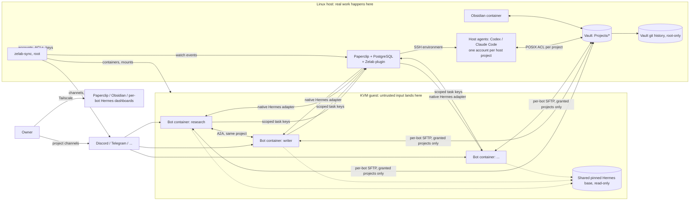

# Zelab v2 architecture (proposal)

Status: design agreed with the owner on 2026-10-14, not implemented. Items under
[To verify while building](#to-verify-while-building) are assumptions until qualified. The
current system is described in [ARCHITECTURE.md](ARCHITECTURE.md) and
[TRUST_MODEL.md](TRUST_MODEL.md); this page replaces both when v2 ships.

## Goal

Several Hermes bots and Paperclip host agents work on **projects**. Every project
has one folder of human-readable memory in the Obsidian vault. You decide, per
project, which bots and agents are assigned to it (assigned agents get full
access, everyone else none) and whether it may touch the host. Your own notes are
simply a project with no agents assigned. Bots keep every Hermes feature; safety comes from where things run and
which credentials they hold, never from disabling tools or from prompt text.

Typical use: "@research do the market research for Acme" in the Acme Discord
channel ends with notes in `Projects/acme/` in Obsidian, a ticket on the
Paperclip board, and, if host work was needed, a host agent having done it.

## Decisions

| Topic | Decision |
| --- | --- |
| Hermes features | Everything enabled except computer use, which needs a desktop: code execution, browser, plugins, MCP, cron, delegation, skills, A2A. The Research drift lock and toolset restrictions are removed. |
| Isolation | Keep the KVM guest as the wall to the host. One lightweight container per Hermes bot inside it. |
| Bot base | One pinned Hermes install shared read-only by every bot, with Chromium, all Python extras and ffmpeg. Each bot has its own writable layer and data. Computer use is off. All bots run the same Hermes version. |
| Guest size | 4 vCPU, 6-8 GiB RAM, 20 GiB thin disk that `make` can grow. |
| Source of truth for memory | The vault. Hermes native memory stays per bot and small. |
| Registry | Paperclip: one company, many projects. A Paperclip project is the unit of access. |
| Grants | Assigned means full access, not assigned means none. An assignment is Paperclip's `tasks:assign_scope` grant scoped to the project's ID, which also lets the agent assign tickets inside that project. Paperclip 2026.1005.0's core UI cannot edit it: the UI defers "scoped assignment and explicit grant controls" to installed organization-settings extensions, and the member-permissions API refuses agent members. A small Zelab Paperclip plugin therefore provides the owner-only screen. It sets assignments and the project lead, and writes grants through the plugin host's `setGrants`. |
| Missions | Any agent task. Real work becomes a Paperclip ticket; quick exchanges stay in chat. The bot decides with rules from a Zelab skill; the owner can override. |
| Bots in Paperclip | Every bot is also a Paperclip agent (native Hermes gateway adapter), so tickets flow both ways. |
| Bot-to-bot | Light path: Hermes's native A2A plugin. Bots call each other directly over HTTP inside the guest, each with its own token per peer, whatever chat platform they use. Optional visible path: @mentions in a shared chat channel (`DISCORD_ALLOW_BOTS`, `TELEGRAM_ALLOW_BOTS` or Slack `allow_bots` set to `mentions`). Heavy path: Paperclip tickets and comment @mentions. Handoffs happen only between agents assigned to the same project. |
| Messaging | Each bot uses whichever platform it is set up with: Discord, Telegram, Slack and others, through Hermes's native gateway setup. Zelab automates Discord only: one channel per project, and Discord roles decide which bots can see it. Chats on other platforms are managed by the owner. Paperclip has no chat entry point. |
| Host agents | Paperclip's Codex and Claude Code agents run on the host and do real sysadmin, DevOps and repository work. Each host-enabled project has its own host account with a rights preset. Paperclip picks a run's SSH environment from the agent (`defaultEnvironmentId`), not from the project, so each host project has its own host agent per harness. |
| Host gate | Per project: `host_auto` lets granted bots assign host agents directly; otherwise bots file tickets and the owner assigns. |
| Project memory writes | Each agent writes only its own log in the project. Only the project lead (set in the Zelab plugin) and the owner can write `MEMORY.md`. File ACLs applied by the sync enforce this. |
| Version history | The host commits the vault to a git history every few minutes. Bots cannot reach that history. |
| Model credentials | Subscription OAuth, with **a separate login per bot and per host agent**. Single-use refresh tokens cannot be shared across containers or host accounts, so v1's copy of one Codex auth file is not reused. |
| Owner Obsidian access | Browser only, through the existing Obsidian container. |
| Admin UI | No separate Zelab app. Bots, projects and agents are managed in Paperclip's own UI, assignments in the Zelab plugin screen inside Paperclip, and host rights in `config/projects.yaml` + `make`. |
| Migration | Fresh start: the current Hermes profiles, vault layout and Paperclip company are not carried over. |
| Delivery | One refactor, switched over once. |

## Layout



## Components

| Component | Runs as | Purpose |
| --- | --- | --- |
| KVM guest | `zelab-vm` | The bot box. Its nftables rules stay as today: only the Paperclip API and the notes SFTP port reach the host. Each bot's API and dashboard ports are forwarded to host loopback at runtime through QEMU's QMP `hostfwd_add`, and re-added when the VM restarts, so adding a bot needs no VM restart. |
| Bot container | One unprivileged container per bot. Root inside is mapped to an unprivileged guest UID. | One Hermes home, gateway, API server and dashboard. Mounts: shared base (read-only), its own data, assigned project folders under `/vault/Projects/<slug>`, and a read-only `/zelab` folder with its grants and the Zelab skill. Its A2A port is reachable only from bots assigned to the same project (guest firewall). |
| Shared base | Read-only image layer | The pinned upstream installer output with browser, extras and ffmpeg. Upgraded only through a qualified pin change. |
| Paperclip | `zelab-paperclip` on host loopback | Registry (projects, agents, grants), ticket board, and dispatch to bots and host agents. `requireBoardApprovalForNewAgents` is on, so agents are created through `/agent-hires` and approved. |
| Host agents | Per-project host accounts `zelab-p-<slug>` | Codex or Claude Code through Paperclip's SSH environment driver, with the rights of their project's preset. |
| Vault | Host `/var/lib/zelab-vault` | `Projects/<slug>/` only. Each project has one POSIX group for its assigned agents. |
| Vault history | Root timer, git directory outside the vault | Snapshot commits every few minutes. Restore is a git checkout run by the owner. |
| zelab-sync | Root service on the host | Watches Paperclip's live event stream, with polling as a fallback. Applies the state described below. It never sits between an agent and its data. |
| Discord admin bot | Token readable only by root, used only by zelab-sync | Creates project channels and per-bot roles and keeps them aligned with grants. Hermes bots never hold it. |
| Zelab Paperclip plugin | Inside Paperclip, installed by `make` | Owner-only screen to assign agents to projects and set each project's lead. Rejects every caller except the owner's board session. |

## What zelab-sync applies

Inputs: Paperclip projects, agents and `tasks:assign_scope` grants, plus `config/projects.yaml`. The
sync is idempotent: it computes the desired state and converges to it.

| Paperclip event | Applied state |
| --- | --- |
| Project created | `Projects/<slug>/` with `MEMORY.md`, `Agents/`, `Missions/`, its group, and a Discord channel visible to nobody but the owner |
| Agent hired with the Hermes adapter | Bot container, guest UID, SFTP identity, Paperclip API key for the adapter, API and dashboard port forwards with a Tailscale Serve route, Discord role. The owner then creates the chat application, enters its token in the bot's dashboard, and signs the bot in to its model subscription. |
| Grant added, changed or removed (owner only) | SFTP account ACLs and container mounts, with a restart of that bot; file ACLs on `MEMORY.md` (lead and owner) and on each agent's own log; host project group membership; Discord role; A2A peer tokens and guest firewall rules between same-project bots; task key `projectIds` and `allowedAssigneeAgentIds` (same-project agents only, plus host agents when `host_auto`); the `/zelab/grants.json` the bot reads |
| Agent retired | Container stopped and data archived, keys revoked, roles removed |

Only grants written by the Zelab plugin are honoured; any other `tasks:assign_scope`
grant is ignored and reported. No agent
may have the `ceo` role or `users:manage_permissions`; the sync reports any
agent that does. Host accounts are created only from `config/projects.yaml`, never from
Paperclip data.

## Setup flow

Plain `make` stays the only installer. When it runs interactively it asks:

1. **How many Hermes bots?** The default is the number that already exist, or 1
   on a fresh site. A higher number adds bots; `make` never removes one. To
   retire a bot, use Paperclip.
2. For each new bot: **a name and a one-line role**. These become the bot's
   Paperclip agent and its Hermes profile description.
3. For each new bot, any of these steps can be skipped:
   - **Model sign-in:** the native `hermes setup model` wizard, including the
     subscription OAuth login.
   - **Messaging:** the native `hermes setup gateway` wizard for the platform you
     choose for that bot (Discord, Telegram, Slack…). It takes the platform token
     in the terminal, never in chat. The guide first shows how to create the
     platform's bot application, since that step cannot be automated.
   - **SOUL:** paste a persona or open an editor; otherwise Hermes seeds its
     default.

Once per site, `make` also takes the Discord admin bot token as hidden terminal
input (skippable: project channels are then not automated), creates the sync's
Paperclip board API key itself, and installs the Zelab plugin. Both secrets stay
root-only on the host.

Skipped steps appear in the HTML checklist and can be finished later in that
bot's dashboard. A noninteractive `make` reads `hermes_bots: <n>` from the site
config and skips every wizard. Bots hired later in Paperclip are built by the
sync service and configured in their dashboards, with no `make` run.

## Host rights: `config/projects.yaml`

```yaml
projects:
  homelab:                 # Paperclip project slug
    host_preset: full-sudo # none | monitor-readonly | docker | repo-dev | full-sudo
    host_auto: false       # bots file host tickets; the owner assigns
    paths: [/srv/homelab]
  acme:
    host_preset: none      # research only, no host agents
```

Presets are a fixed catalogue in Zelab: groups, sudoers fragments and owned
paths. A project without an entry has no host account, and Paperclip cannot
dispatch host work for it.

## Memory layers

1. **Bot memory**: Hermes native `MEMORY.md`/`USER.md` in each container, private
   to that bot. Holds who it is and what it has learned, not project facts.
2. **Project memory**: `Projects/<slug>/MEMORY.md`, curated by the Paperclip
   project lead and the owner. It's the first file a bot reads when it works on
   the project.
3. **Agent logs**: `Projects/<slug>/Agents/<agent>.md`, append-only per agent.
   The lead consolidates them into `MEMORY.md`.
4. **Mission notes**: `Projects/<slug>/Missions/<ticket>-<slug>/`, linked from the
   Paperclip ticket.
5. **Work history**: Paperclip tickets, comments and documents.

Recall uses a Zelab Hermes skill, `zelab-projects`, mounted read-only into every
bot. It covers the granted projects (from `/zelab/grants.json`), the folder
conventions, when to escalate to a ticket, and same-project handoffs. Each bot
gets `OBSIDIAN_VAULT_PATH=/vault`, so the upstream `obsidian` skill works too.
The skill is guidance; the boundaries are the mounts, file ACLs, keys, Discord
roles and the guest firewall.

## Trust boundaries

Every boundary lives outside the bot. A bot can rewrite its own Hermes config,
skills and SOUL, so none of those can be a security limit.

| A hijacked bot can | It cannot, because |
| --- | --- |
| Do anything inside its container, use its subscription login, and read or write its granted projects | It cannot read another bot's data or ungranted projects: container and SFTP account ACLs prevent it |
| File tickets in its granted projects | It cannot assign host agents unless the project is `host_auto`: the Paperclip task key's allowed assignees prevent it |
| Message bots in its project channels, or call same-project bots over A2A | It cannot see other projects' Discord channels or reach other bots' A2A ports: Discord roles, peer tokens and the guest firewall prevent it |
| Damage files in an assigned project | It cannot erase the history: the git history is root-only on the host |
| Ask for more access in a ticket | It cannot grant access: only the owner's grants are applied |

Accepted risks:
- Information flows between bots that share a project.
- A guest kernel or container-runtime escape exposes every bot's granted projects (the union), but still not the host.
- A `host_auto` project gives its granted bots a path to that project's host preset.
- A host agent with the `full-sudo` preset is root on the host. It can read every
  project, Paperclip's database and Zelab's secrets, so project boundaries do not
  apply to it.
- A hijacked bot can steal its own subscription login. Revoke that session at
  the provider.
- Chats on platforms other than Discord are not managed by Zelab. Who sees them
  is the owner's setting in that platform.

## Resource budget

Measured on 2026-10-14 in the current guest: one idle Hermes gateway uses
about 220 MB RSS, the dashboard about 210 MB, and the guest disk holds 3.5 GB.

| | Estimate |
| --- | --- |
| 5 idle bots with dashboards | about 2-2.5 GB RAM |
| Browser sessions while active | +0.3-0.8 GB each |
| Guest disk used | about 6-7 GB of a 20 GiB thin ceiling |

## Operations

- `make backup` archives Paperclip, the vault and its git history, every bot's
  data directory, `config/projects.yaml` and the private deployment state.
  `make restore` brings all of it back and rebuilds containers, forwards,
  accounts and ACLs from Paperclip and the config.
- `make fclean` and `make re` also remove bot containers, per-project host
  accounts, the plugin and the sync, after the usual preview and confirmation.
- Plain `make` stays idempotent: a second run changes nothing. It also
  converges whatever the sync manages, so a missed event is repaired.

## Removed from v1

- Research profile drift lock, toolset allowlist, parked reserve pool and `BOT_POOL.md`.
- Owner and shared notes users, `Private/` and `Shared/`.
- The Operations Hermes profile's Private access and its `zelab-ops` host worker. Host work moves to per-project accounts.
- The inert submission agent and the single "Hermes Operations" remote agent. Each bot is now its own Paperclip agent with its own keys.
- The `AGENTS.md` ban on brokers and dashboards is narrowed to allow zelab-sync (a state applier, not a broker in the data path) and the Zelab Paperclip plugin (Paperclip's native extension point).

## Verified against Paperclip 2026.1005.0 (source read, not run)

- The core UI has no editor for scoped grants. Agents are not editable members (`routes/access.js:949,997`). `tasks:assign_scope` with an empty scope allows nothing (`services/authorization.js:170,395`). Plugins can write grants (`plugin-host-services.js:2714`).
- Plugin actions only require authentication (`routes/plugins.js:1270`), so the Zelab plugin itself must reject anyone but the owner's board session.
- A run's environment comes from the agent, then the instance default (`services/execution-workspace-policy.js:227-252`). Environments are created by a board instance admin.
- Several `hermes_gateway` agents can coexist. Agent creation does not probe `apiBaseUrl`, and `PATCH /agents/:id` can replace `adapterConfig` later.
- Every activity entry is published as an `activity.logged` live event, including `project.created`, `agent.created` and grant updates. The bus is in memory with no replay, and some grant writes are not logged, so the sync listens and also polls.
- `requireBoardApprovalForNewAgents` makes `POST /agents` return 409 for everyone. Zelab must create agents through `/agent-hires` and approve them. Today's `paperclip_workers` and `paperclip_hermes` roles use `POST /agents`.
- Agents can obtain `users:manage_permissions` (invite defaults, a CEO agent's company import, plugins), but even with it they cannot edit member grants. The sync reports any agent with the `ceo` role or that key.

## To verify while building

1. The Zelab plugin: an owner-only check for its actions, a `companySettingsPage` or project tab, and `setGrants` writing project-scoped `tasks:assign_scope`.
2. The Hermes adapter package does not probe at create time (the package was not in the downloaded tarball).
3. Container runtime choice (rootless podman or systemd-nspawn) with a shared read-only base and a per-bot writable layer. Measure RAM and disk with 5 bots.
4. A per-bot Hermes dashboard behind its own Tailscale Serve port with its own password.
5. A per-container subscription login (`hermes auth add`) stays valid while other bots use the same account.
6. Discord channel visibility through managed roles, plus `*_ALLOW_BOTS=mentions` between bots.
7. `make` grows an existing guest disk and filesystem.
8. The shared base stays immutable and self-improvement lands in each bot's data directory.
9. A2A between two bot containers with per-peer tokens and guest firewall rules; its token cost compared with a ticket.
10. The sync's board credential: a Paperclip board API key held only by root on the host.
11. Runtime QMP `hostfwd_add` and removal for bot ports, and their restoration after a VM restart.
12. Setting `leadAgentId` on a project through the API, from the plugin.

## Success criteria

v2 is done when every criterion below **passes live on the reference site**,
with sanitized evidence recorded in `docs/STATUS.md`. A parsed config, a passing
unit test or an HTTP 200 is not a pass. Anything not exercised is reported as
NOT RUN, and v2 is not done while any G, X or O criterion is NOT RUN.

### G: the main goal, end to end

- **G1 Research to Obsidian.** In project `acme`'s chat channel, "@research do
  market research on <topic>" produces a Paperclip ticket in `acme` and notes
  under `Projects/acme/Missions/<ticket>-<slug>/` with a source URL for every
  claim. A dated entry appears in the bot's `Agents/research.md`, and the notes
  are visible in Obsidian in the browser. The ticket links to the notes.
- **G2 Host work through Paperclip.** In a host project that is not
  `host_auto`, a bot files a host ticket, the owner assigns it, the project's
  host agent runs as `zelab-p-<slug>`, and the result comes back on the ticket
  and in the bot's channel.
- **G3 Work sent to a bot.** A ticket that the owner or a host agent assigns to a
  bot is executed by that bot and answered on the ticket.
- **G4 Bot to bot.** Two bots assigned to the same project hand work over by A2A,
  by chat @mention and by ticket.

### M: modular and dynamic, without `make`

- **M1** A project created in Paperclip gets its vault folder and Discord channel
  within 2 minutes.
- **M2** A Hermes bot hired in Paperclip is running within 5 minutes, with its
  dashboard on its own Tailscale URL and its API reachable by Paperclip. The VM
  is not restarted and no other bot restarts.
- **M3** Assigning or unassigning an agent in the Zelab plugin updates mounts,
  file ACLs, Discord visibility, A2A reach and task-key scope within 2 minutes.
- **M4** A new host agent hired in Paperclip for an existing host project runs as
  that project's account.
- **M5** A bot set up on Telegram (or any non-Discord platform) works like a
  Discord bot, except for Zelab-managed channels.
- **M6** Plain `make` asks how many bots and runs the skippable per-bot wizards.
  A noninteractive `make` with `hermes_bots: 3` builds 3 bots without prompting.
  Raising the number adds bots and never removes any.

### X: boundaries hold against a hijacked bot (negative tests)

Run as root inside a bot container, after rewriting that bot's own Hermes config:

- **X1** It cannot read an unassigned project, another bot's data, the host
  filesystem, the vault history or any Zelab or Paperclip secret.
- **X2** It cannot reach another bot's A2A port unless both are assigned to the
  same project. It cannot reach host services other than the Paperclip API and
  the notes SFTP port, nor the LAN or the tailnet.
- **X3** Its task key cannot create tickets in unassigned projects, nor assign a
  host agent in a project that is not `host_auto`.
- **X4** Calling a Zelab plugin action with its key is refused. A grant written
  outside the plugin is ignored and reported by the sync.
- **X5** It cannot see the channels of unassigned projects on Discord, even after
  adding them to its own allowed channels.
- **X6** If it is not the project lead, it cannot write the project's `MEMORY.md`
  or another agent's log.
- **X7** After it wipes an assigned project, the owner restores the folder from
  the vault history.

### F: Hermes is not crippled

- **F1** In one bot: code execution, the browser tool, web extraction, an MCP
  server, installing a plugin with a Python dependency, a cron job, delegation
  and Discord voice messages all work. The installed plugin affects no other
  bot.

### R: resources

- **R1** With 5 idle bots the guest uses no more than 3 GB of RAM and 8 GB of
  disk. The guest is sized at 4 vCPU, 6-8 GiB RAM and a 20 GiB thin disk.
- **R2** Raising `vm_disk_gib` and running `make` grows the guest disk and its
  filesystem without data loss.

### O: operations

- **O1** A second `make` reports zero changes, and an interrupted `make` resumes.
- **O2** `make backup`, then `make fclean`, then `make restore` on the reference
  site brings back Paperclip, the vault and its history, every bot (memory,
  sessions, logins) and the host accounts, and a host task then runs.
- **O3** `rtk proxy python3 tools/check.py` passes and gitleaks is clean.
  `ARCHITECTURE.md`, `TRUST_MODEL.md`, `SETUP.md`, `OPERATIONS.md`, `STATUS.md`,
  `checklist.html` and `AGENTS.md` describe v2, and this page is folded into
  them.
